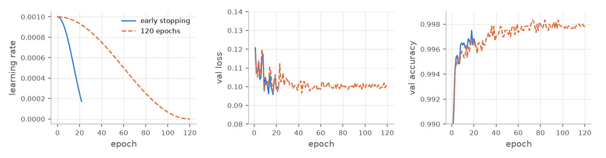
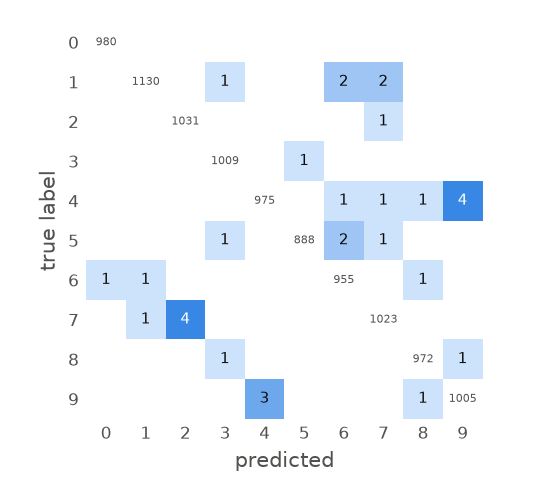
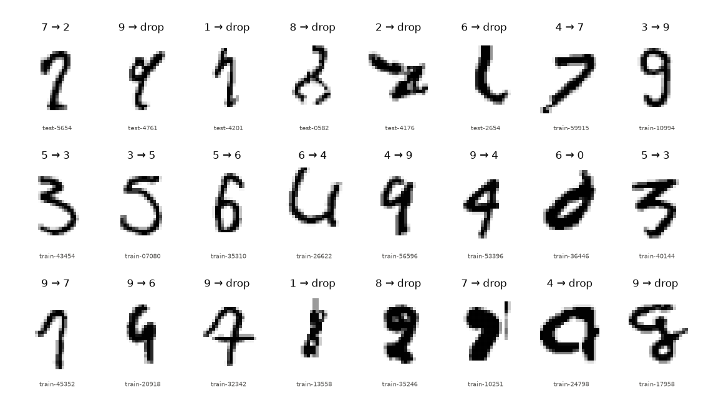

# mnist-showcase

Handwritten digits from scratch to curated data: a hand-written NumPy network verified by a
gradient check, a regularised PyTorch CNN at 99.67 % test accuracy, and label errors found by
cross-validated confident learning, reviewed in the browser and used to retrain the model.

The browser tool for live training runs, evaluation and the review queue is
[ml-workbench](https://github.com/alb-i/ml-workbench). The technical report
([reports/report.pdf](reports/report.pdf), source [reports/report.tex](reports/report.tex)) has
the derivations, all experiments and the curation analysis.

<p align="center"></p>

*The workbench: a live training run, a click in the confusion matrix, relabelling in the review
queue with the keyboard.*

## Results

Original MNIST test set (10 000 images); E7 and E8 are mean ± std over three seeds.

| Model | Experiment | Test accuracy |
|---|---|---|
| Logistic regression | E1 | 92.54 % |
| k-nearest neighbours (k = 3) | E1 | 96.90 % |
| MLP 784-256-128-10, own NumPy implementation, Adam | E2 | 97.84 % |
| The same MLP in PyTorch | E3 | 97.90 % |
| Small CNN | E4 | 98.95 % |
| Regularised CNN (BatchNorm, dropout, augmentation, label smoothing, AdamW + OneCycle) | E7 | **99.67 ± 0.03 %** |
| Ensemble of the five cross-validation models | CV | 99.73 % |
| Regularised CNN trained on the curated data | E8 | 99.60 ± 0.09 % |

Curation round 1 reviewed 261 candidates (≈ 40 minutes) and changed 90 training labels (51
relabels, 39 drops) and 6 test labels. Retraining did not change the accuracy measurably (the
difference is below the ≈ 0.15 points a 10 000-image test set can resolve), but 3–5 of the final
model's 31–36 test errors turned out to be images with a wrong or unreadable label.

<p align="center"></p>

*Regularised CNN: with label smoothing the validation loss stays near a floor of ≈ 0.1 while the
accuracy keeps rising, so early stopping on the loss (blue) ends training too soon; the final
runs use the full 120-epoch schedule (orange).*

<p align="center"></p>

*Confusion matrix of the final model (E7, seed 0) on the test set: 32 errors, mostly 4 ↔ 9 and
7 → 2.*

<p align="center"></p>

*Label errors found and fixed: given label → new label, or drop. First row: the six changed test
images, then training images in review-queue order.*

## Reproduce in 3 commands

```bash
git clone https://github.com/alb-i/mnist-showcase && cd mnist-showcase && cp .env.example .env  # then set DATA_DIR / RUNS_DIR
micromamba create -f environment.yml && micromamba run -n mnist-showcase bash -c "pip install --no-deps -e . && python scripts/download_mnist.py"
scripts/run_e7.sh --lr 1e-2 --set scheduler=onecycle     # final model, 3 seeds, ≈ 11 min on an RTX 2070
```

This repository is a snapshot of the code that produced every run in the report, and it
reproduces them: the scripts in the table under [Experiments](#experiments) repeat each
experiment, the cross-validation and the curation comparison. Every run folder records its
resolved `config.yaml` and the dataset version (a hash of the `sample_id,action,new_label`
columns of `curation/decisions.csv`); to repeat any single run, call
`micromamba run -n mnist-showcase train $RUNS_DIR/mnist/<run-id>/config.yaml`. The curated data
is the committed `curation/decisions.csv` applied on top of the unchanged raw files;
`scripts/run_e8.sh` retrains on it.

## Setup (for development)

```bash
cp .env.example .env          # adjust DATA_DIR / RUNS_DIR
micromamba create -f environment.yml
micromamba run -n mnist-showcase pip install --no-deps -e . -e ../ml-workbench
micromamba run -n mnist-showcase python scripts/download_mnist.py
micromamba run -n mnist-showcase pytest -q
```

## Experiments

Start each experiment in the tmux window `train`; runs appear in the workbench.

Sanity checks before a long run (plan 9):
- `micromamba run -n mnist-showcase python -m digits.sanity overfit configs/cnn_reg.yaml` fits one
  batch of 128 training images for 300 steps (no augmentation, no label smoothing, constant lr) and
  prints PASS if the training loss ends below 0.01 (≈ 10 s; logged as run `sanity-overfit`).
- Every run with augmentation writes `samples/augmented.png` (64 training images as the model gets
  them, with labels); look at it on the run's Live page in the workbench.

| # | Command | What |
|---|---------|------|
| E1 | `scripts/run_e1.sh` | Logistic regression and k-NN on flattened pixels (`--only logreg` / `--only knn`) |
| E2 | `scripts/run_e2.sh` | Own NumPy MLP 784-256-128-10, SGD with momentum vs. Adam (target ≥ 97.5 % test) |
| E2b | `scripts/run_sgd_ls.sh` | SGD with Armijo backtracking line search, NumPy and PyTorch MLP (`--full-batch`: every step on the whole training set) |
| E3 | `scripts/run_e3.sh` | PyTorch MLP with the E2 settings, SGD vs. Adam (same numbers as E2?) |
| E4 | `scripts/run_e4.sh` | Small CNN conv(32)-conv(64)-pool-dropout-fc(128)-fc(10) (≈ 99.2 % test) |
| E5 | `scripts/run_e5.sh` | Regularised CNN, LR sweep 3e-4 … 3e-2 × OneCycle/cosine (10 runs of 120 epochs without early stopping, ≈ 3.5 min each) |
| E6 | `scripts/run_e6.sh --lr 1e-2 --set scheduler=onecycle` | Ablation: full config, then augmentation / BatchNorm / dropout / label smoothing off |
| E7 | `scripts/run_e7.sh --lr 1e-2 --set scheduler=onecycle` | Best config, seeds 0–2, deterministic kernels: mean ± std |
| CV | `scripts/run_cv.sh [--no-ls] [folds]` | 5-fold cross-validation over all 60 000 training images with the E7 config (`--no-ls`: without label smoothing), last epoch (≈ 3.4 min per fold): out-of-fold predictions for finding label errors (plan 10.2); then `python -m digits.label_issues collect [--prefix cv-nols]` writes the run `<time>-cv-oof` with the review candidates |
| E8 | `scripts/run_e8.sh` | E7 config on the curated data (committed `curation/decisions.csv`), seeds 0–2; then `python -m digits.curation_report` compares E7 (original data) and E8 on the original and the curated test set |

Evaluation of finished runs (test accuracy with 95 % CI, macro-F1, ECE before/after temperature
scaling fitted on val; `--errors` lists the misclassified test images with top-3 probabilities):
`micromamba run -n mnist-showcase python -m digits.evaluate $RUNS_DIR/mnist/<run-id> [...]`

Tables of runs by name prefix (best by val accuracy; mean ± std for ≥ 2 runs):
`micromamba run -n mnist-showcase python -m digits.summarize e5- [--since <yyyymmdd>-<hhmmss>]`

Single PyTorch runs: `micromamba run -n mnist-showcase train configs/cnn_reg.yaml [--lr 3e-3]
[--epochs N] [--seed S] [--set key=value] [--deterministic]`; continue a stopped run with
`train --resume $RUNS_DIR/mnist/<run-id>`.

## Licence

MIT, see [LICENSE](LICENSE).
